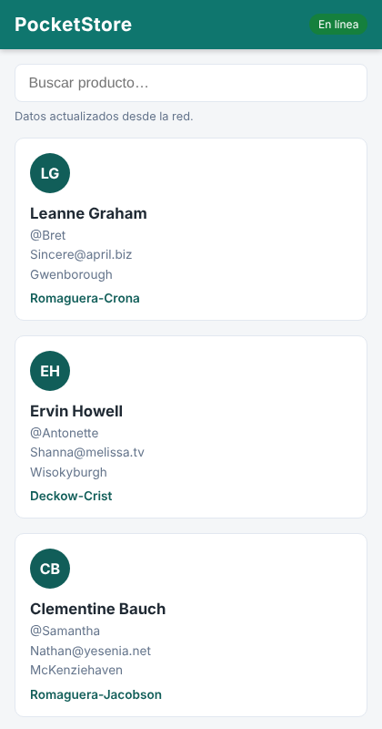
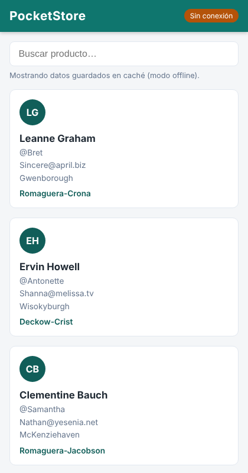
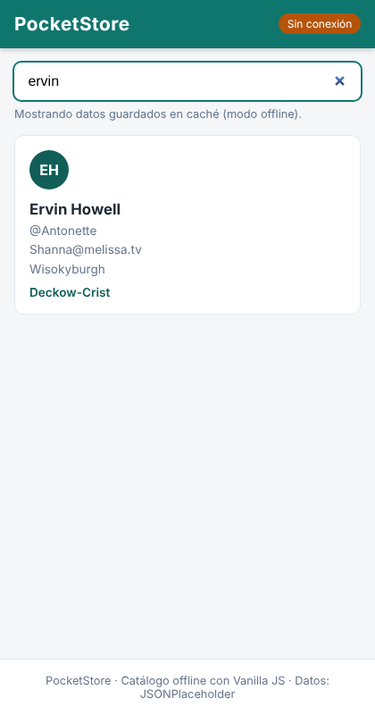

# PocketStore (PWA con Vanilla JS)

Catálogo de una sola página que lista elementos obtenidos de una API pública y **funciona sin conexión a internet**. Desarrollado sin frameworks: HTML, CSS y JavaScript puro.

## Estructura del proyecto

```
/pocket-store
├── index.html      # Vista (App Shell)
├── styles.css      # Estilos del App Shell
├── app.js          # Lógica de la aplicación y registro del SW
├── sw.js           # Controlador (Service Worker y caché)
├── manifest.json   # Configuración de instalación (manifiesto)
├── icons/          # Iconos 192x192 y 512x512
└── docs/img/       # Capturas del proceso de desarrollo
```

## Implementación por componente

### 1. Manifiesto (`manifest.json`)
Escrito a mano. Define `name`, `short_name`, `start_url`, `display: "standalone"`, `background_color` (`#ffffff`), `theme_color` (`#0f766e`) y dos iconos (192x192 y 512x512). Las rutas son relativas para que funcione también en GitHub Pages (subcarpeta del repositorio).

### 2. App Shell (`index.html` y `styles.css`)
Estructura estática con barra superior (título e indicador de conexión), contenedor principal y pie de página. Incluye tarjetas "esqueleto" que se muestran al instante mientras llega el contenido dinámico.

### 3. Service Worker (`sw.js`)
Ciclo de vida completo:

| Evento     | Qué hace |
|------------|----------|
| `install`  | Precachea el App Shell (`index.html`, `styles.css`, `app.js`, `manifest.json`, iconos). |
| `activate` | Elimina cachés de versiones anteriores y toma control de las páginas abiertas. |
| `fetch`    | **Cache First** para el App Shell; **Network First** con respaldo en caché para la API. Si la respuesta viene de caché, se marca con el encabezado `X-From-Cache`. |

### 4. Contenido dinámico (`app.js`)
Consume `https://jsonplaceholder.typicode.com/users` con `fetch()`, renderiza tarjetas, ofrece búsqueda en vivo y muestra si los datos vienen de la red o de la caché. También registra el Service Worker y detecta los eventos `online`/`offline`.

## Cómo ejecutarlo

Los Service Workers requieren `http://localhost` o HTTPS.

```bash
cd pocket-store
python3 -m http.server 8000
# abrir http://localhost:8000
```

Para probar el modo offline:
1. Abrir la app con conexión una vez (se llena la caché).
2. En DevTools → *Application* → *Service Workers*, marcar **Offline** (o desconectar la red) y recargar.
3. El catálogo se sigue mostrando desde la caché.

## Evidencias

**Con conexión:** datos obtenidos desde la red.



**Sin conexión:** el App Shell y el catálogo se cargan desde la caché.



**Búsqueda funcionando offline.**



> Nota: las capturas se tomaron con Chromium automatizado y un servidor local que devuelve el mismo esquema de datos que JSONPlaceholder, porque el entorno de generación no tenía acceso a esa API. El código del repositorio apunta a la API real.

## Tecnologías

HTML5 · CSS3 · JavaScript (ES6+) · Service Workers · Cache API · Web App Manifest
